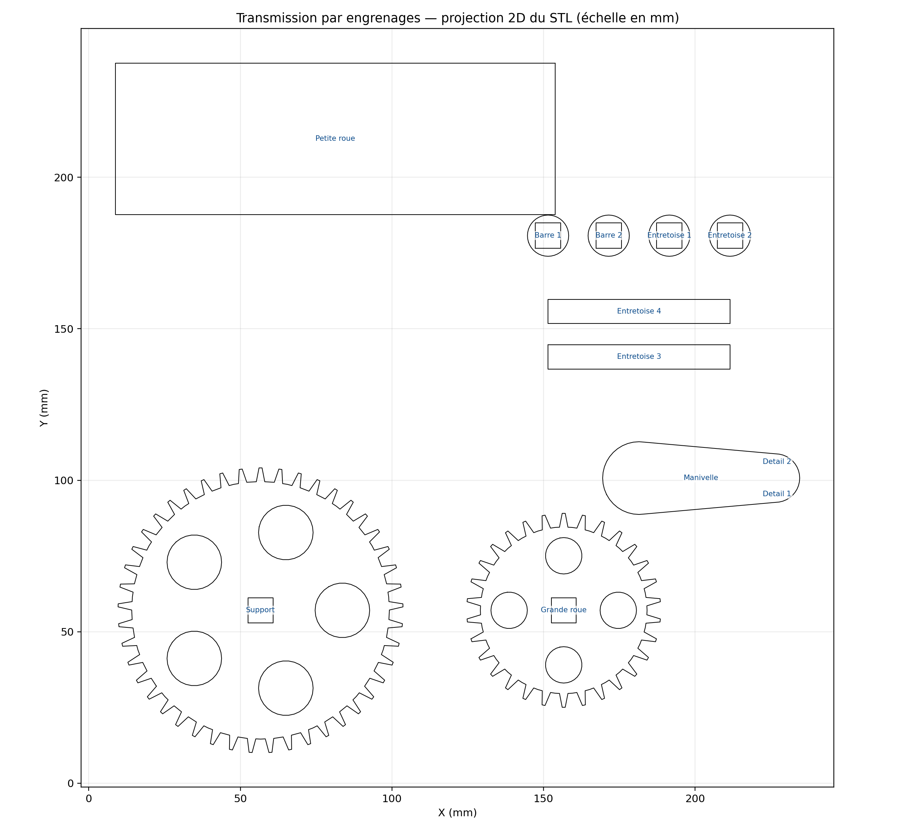
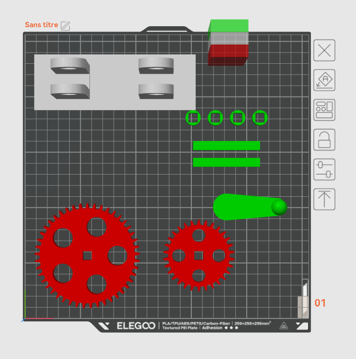
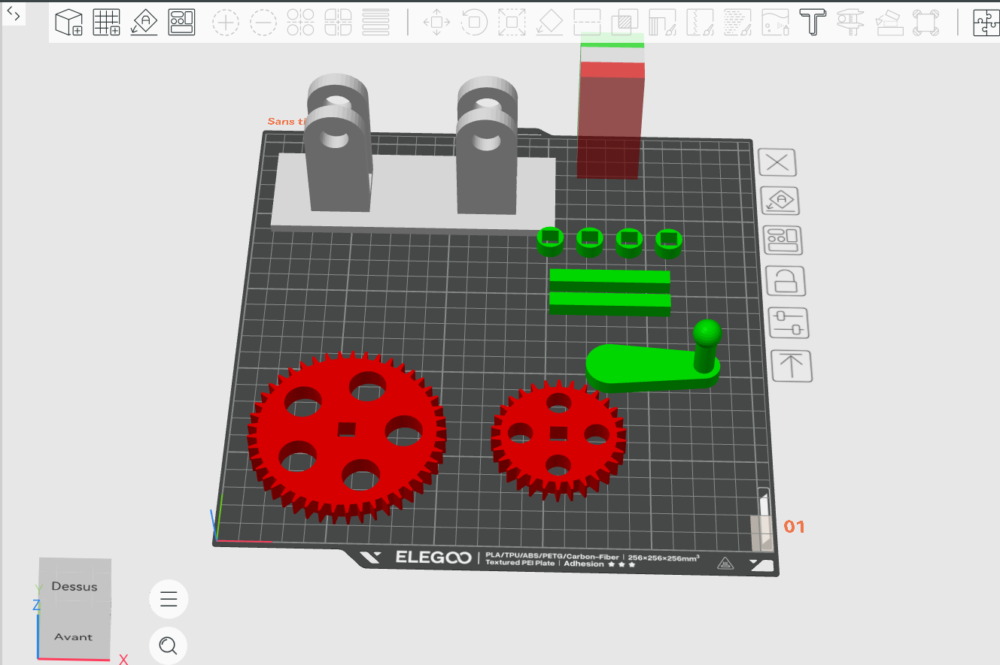
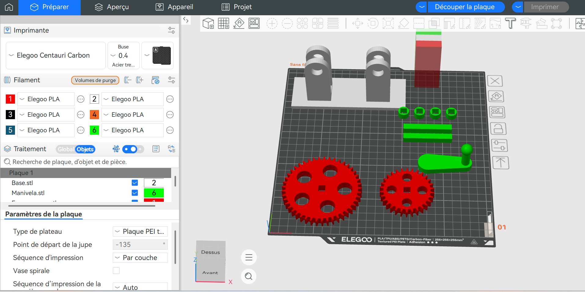
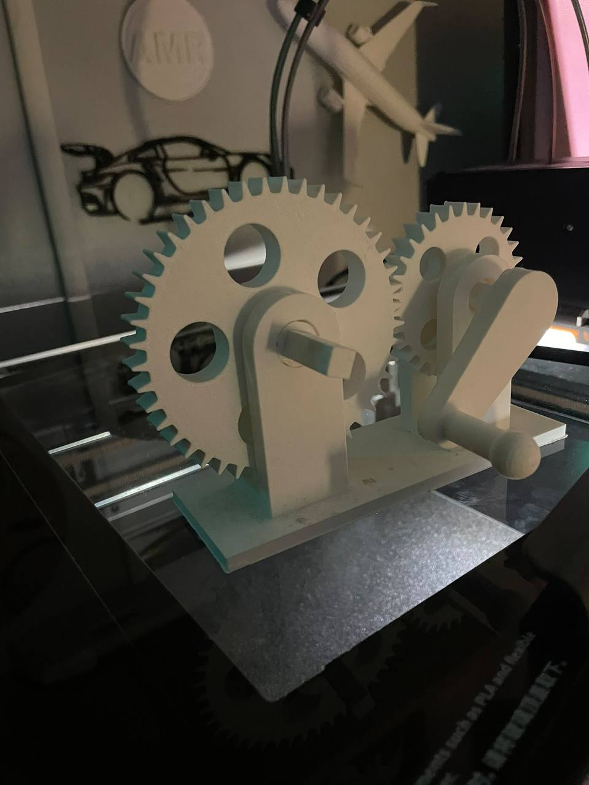
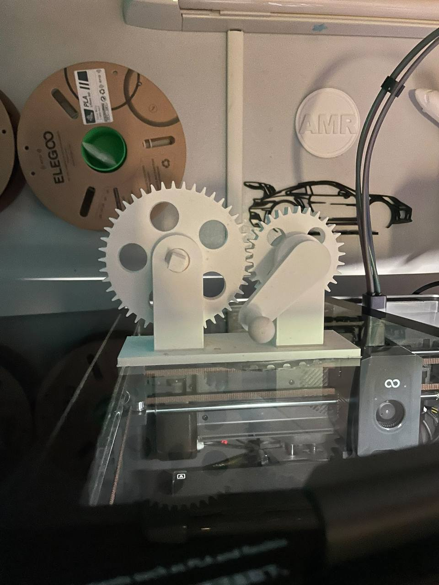
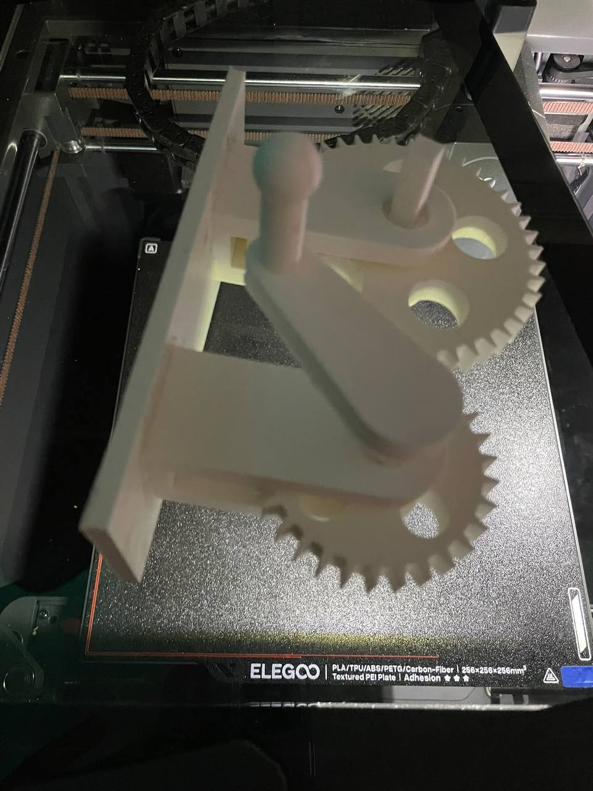
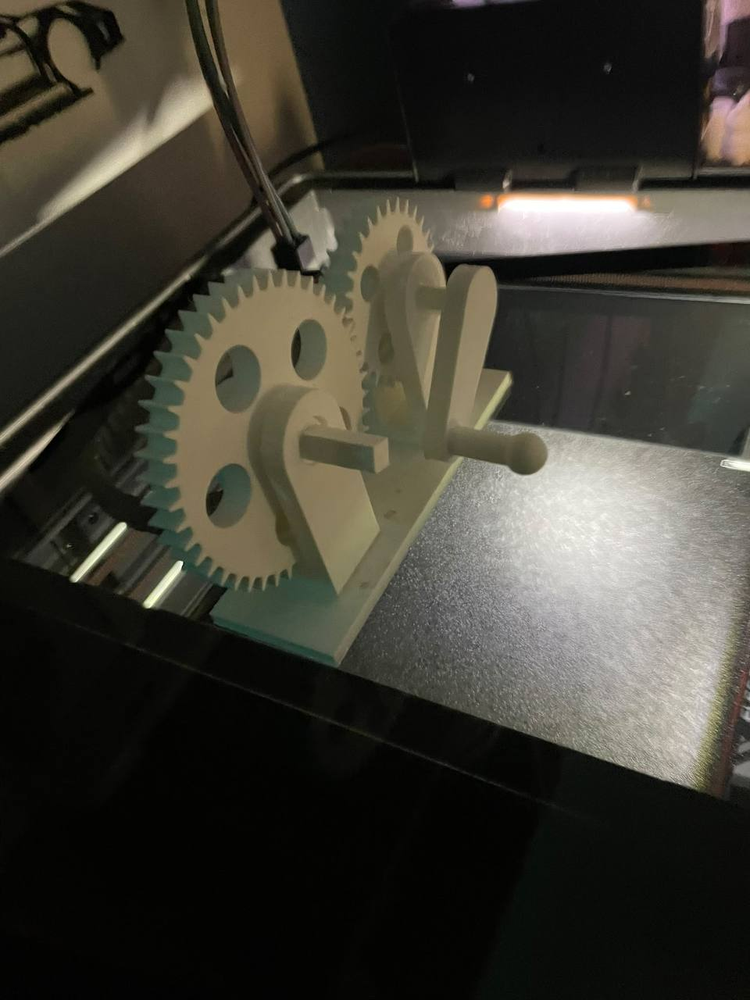

# ⚙️ Transmission de puissance par engrenages

### Étude mécanique | Dimensionnement | Analyse cinématique | Fabrication additive

**Projet technique en ingénierie mécanique — Orientation mécatronique**

---

## 1. Présentation du projet

Ce projet porte sur l'étude et la réalisation d'un mécanisme de transmission de puissance par engrenages cylindriques à denture droite.

Le système comprend deux roues dentées, un support mécanique, des éléments de guidage et une manivelle permettant l'entraînement manuel.

L'objectif est de relier les connaissances théoriques en ingénierie mécanique aux contraintes pratiques de fabrication, d'assemblage et de fonctionnement d'un mécanisme réel.

Le projet mobilise plusieurs domaines :

- Conception et analyse de systèmes mécaniques.
- Dimensionnement géométrique des engrenages.
- Cinématique et transmission de puissance.
- Exploitation de modèles numériques 2D et 3D.
- Fabrication additive par dépôt de filament fondu.
- Métrologie, jeux fonctionnels et tolérances.
- Documentation et communication technique.

---

## 2. Problématique technique

**Comment réaliser un système de transmission de puissance par engrenages en assurant la cohérence géométrique des composants, le respect des entraxes et un fonctionnement mécanique satisfaisant ?**

Cette problématique nécessite de considérer :

- La géométrie des roues dentées.
- Le rapport de transmission.
- Le positionnement relatif des axes.
- La conception du support et de la manivelle.
- Les contraintes du procédé de fabrication.
- Les jeux et les tolérances d'assemblage.

---

## 3. Étude et dimensionnement des engrenages

### 3.1 Caractéristiques géométriques

L'étude nominale repose sur deux engrenages cylindriques extérieurs à denture droite, de module 2 mm.

| Paramètre | Engrenage 1 | Engrenage 2 |
|---|---:|---:|
| Nombre de dents Z | 60 | 30 |
| Module m | 2 mm | 2 mm |
| Diamètre primitif d | 120 mm | 60 mm |
| Diamètre extérieur da | 124 mm | 64 mm |
| Diamètre de pied df | 115 mm | 55 mm |
| Diamètre de base db | 112,76 mm | 56,38 mm |
| Rayon primitif | 60 mm | 30 mm |
| Angle de pression supposé | 20° | 20° |

**Hypothèses de calcul :**

- Denture droite extérieure.
- Profil standard à développante de cercle.
- Absence de déport de profil.
- Angle de pression de 20°.
- Saillie de dent égale à 1 module.
- Creux de dent égal à 1,25 module.

Ces hypothèses doivent être vérifiées sur la géométrie réelle du modèle STL.

### 3.2 Calcul des diamètres primitifs

Le diamètre primitif est donné par :

**d = m × Z**

Pour la roue Z60 :

d1 = 2 × 60

**d1 = 120 mm**

Pour la roue Z30 :

d2 = 2 × 30

**d2 = 60 mm**

### 3.3 Calcul des diamètres extérieurs

Pour une denture standard sans déport :

**da = m × (Z + 2)**

Roue Z60 :

da1 = 2 × (60 + 2)

**da1 = 124 mm**

Roue Z30 :

da2 = 2 × (30 + 2)

**da2 = 64 mm**

### 3.4 Calcul des diamètres de pied

Pour le profil standard retenu :

**df = m × (Z - 2,5)**

Roue Z60 :

df1 = 2 × (60 - 2,5)

**df1 = 115 mm**

Roue Z30 :

df2 = 2 × (30 - 2,5)

**df2 = 55 mm**

### 3.5 Calcul des diamètres de base

Le diamètre de base est donné par :

**db = d × cos(α)**

Avec α = 20°.

Roue Z60 :

db1 = 120 × cos(20°)

**db1 ≈ 112,76 mm**

Roue Z30 :

db2 = 60 × cos(20°)

**db2 ≈ 56,38 mm**

### 3.6 Calcul de l'entraxe

L'entraxe théorique entre les deux axes est :

**a = (d1 + d2) / 2**

a = (120 + 60) / 2

**a = 90 mm**

Cette valeur constitue une donnée de référence pour l'implantation des arbres et le dimensionnement du support.

### 3.7 Rapport de transmission

Pour deux roues dentées extérieures :

**ω2 / ω1 = -Z1 / Z2**

Si la roue Z60 est motrice :

ω2 / ω1 = -60 / 30

**ω2 / ω1 = -2**

La roue Z30 tourne deux fois plus vite que la roue Z60, dans le sens opposé.

Si la roue Z30 est motrice :

ω60 / ω30 = -30 / 60

**ω60 / ω30 = -0,5**

La roue Z60 tourne alors deux fois moins vite que la roue Z30.

En négligeant les pertes, le couple transmis varie inversement à la vitesse de rotation.

---

## 4. Étude du support mécanique

Le support assure le maintien des axes et le positionnement relatif des engrenages.

### 4.1 Données de dimensionnement

| Paramètre | Valeur |
|---|---:|
| Entraxe nominal | 90 mm |
| Diamètre extérieur roue Z60 | 124 mm |
| Diamètre extérieur roue Z30 | 64 mm |
| Encombrement théorique des roues suivant la ligne des centres | 184 mm |

L'encombrement théorique de 184 mm correspond à la distance entre les extrémités extérieures des deux roues dans la direction de la ligne des centres, lorsqu'elles sont en position d'engrènement.

### 4.2 Proposition de support

| Paramètre | Dimension préliminaire |
|---|---:|
| Longueur de la base | 220 mm |
| Largeur de la base | 100 mm |
| Épaisseur de la base | 10 mm |
| Entraxe des arbres | 90 mm |
| Diamètre nominal des axes | 8 mm |
| Épaisseur minimale proposée des paliers | 12 mm |

Ces dimensions sont des propositions de conception et non des dimensions relevées sur le STL.

La hauteur des axes, l'épaisseur des engrenages, les logements des paliers et les fixations restent à vérifier sur le mécanisme réel.

### 4.3 Fonctions mécaniques

Le support doit :

- Maintenir les axes de rotation.
- Assurer leur parallélisme.
- Respecter l'entraxe théorique.
- Limiter les déplacements indésirables.
- Permettre la rotation des engrenages.
- Assurer une rigidité suffisante pour les sollicitations prévues.

---

## 5. Étude de la manivelle

La manivelle permet d'appliquer manuellement un couple sur l'arbre moteur.

### 5.1 Dimensions préliminaires proposées

| Paramètre | Valeur |
|---|---:|
| Longueur utile du bras | 80 mm |
| Section du bras | 15 × 10 mm |
| Diamètre nominal de fixation | 8 mm |
| Longueur de la poignée | 45 mm |
| Diamètre de la poignée | 20 mm |

Ces valeurs devront être adaptées aux dimensions réelles du modèle et au système de fixation.

### 5.2 Calcul du couple appliqué

La relation mécanique est :

**C = F × L**

Avec :

- C : couple en N·m.
- F : effort tangentiel en N.
- L : longueur du bras de levier en m.

Pour un effort hypothétique de 20 N et un bras de 80 mm :

L = 0,08 m

C = 20 × 0,08

**C = 1,6 N·m**

Ce résultat représente un cas de calcul et ne constitue pas une validation de la résistance de la manivelle imprimée.

---

## 6. Documentation CAO et fichiers techniques

### 6.1 Modèle géométrique 3D

Le modèle STL regroupe les composants destinés à la fabrication additive.

Le format STL décrit les surfaces des pièces à l'aide d'un maillage triangulé.

**[📦 Consulter le modèle STL](Engrenagem+3++Junto.stl)**

### 6.2 Projection technique 2D

Une projection 2D du modèle permet de documenter les contours des composants et d'en faciliter l'analyse géométrique.

**[📐 Télécharger la projection DXF](Transmission_engrenages_projection_2D.dxf)**

Le fichier DXF permet d'exploiter les contours dans un logiciel de CAO compatible.

**Limite technique :** une projection 2D extraite d'un STL ne constitue pas automatiquement un plan de fabrication coté et tolérancé ni une reconstruction paramétrique complète.

---

## 7. Préparation de la fabrication additive

### 7.1 Moyens techniques

| Caractéristique | Configuration |
|---|---|
| Imprimante | ELEGOO Centauri Carbon |
| Logiciel | ELEGOO Slicer |
| Procédé | FDM |
| Matériau | PLA |
| Diamètre de buse | 0,40 mm |
| Hauteur de couche | 0,20 mm |

### 7.2 Implantation des composants

La préparation de fabrication consiste à disposer les différents composants sur le plateau virtuel avant le tranchage.

Cette étape nécessite de considérer :

- L'orientation des pièces.
- Leur encombrement.
- L'adhérence au plateau.
- La nécessité éventuelle de supports.
- Les paramètres d'impression.
- La qualité géométrique recherchée.

### Capture 1 — Préparation du mécanisme

### Capture 2 — Disposition des composants

### Capture 3 — Implantation sur le plateau

---

## 8. Réalisation physique

La fabrication additive permet de produire les composants mécaniques à partir de leur représentation numérique.

L'étude de cette phase porte notamment sur :

- La précision géométrique des dentures.
- La qualité des alésages.
- Les tolérances dimensionnelles.
- L'orientation d'impression.
- Les propriétés mécaniques du PLA.
- Les conditions d'assemblage.

### 8.1 Documentation photographique

Les photographies suivantes documentent la réalisation physique du projet.

#### Photographie 1

#### Photographie 2

#### Photographie 3

#### Photographie 4

### 8.2 Vidéo du projet

La vidéo permet de présenter la fabrication et les différentes étapes de réalisation du mécanisme.

**[🎥 Voir la vidéo du projet](VID.mp4)**

---

## 9. Chaîne numérique de fabrication

Le projet met en évidence l'exploitation de plusieurs formats de données numériques dans une démarche de fabrication additive.

### Chaîne de fabrication

**Modèle STL → Préparation dans ELEGOO Slicer → Tranchage → Impression FDM → Assemblage → Vérification fonctionnelle**

### Documentation géométrique complémentaire

**Modèle STL → Extraction de contours 2D → Fichier DXF → Analyse géométrique**

Cette distinction permet de présenter séparément la chaîne de fabrication et la démarche de documentation CAO.

---

## 10. Assemblage et vérification fonctionnelle

Les contrôles à effectuer concernent :

1. La conformité de l'entraxe de 90 mm.
2. Le positionnement des axes de rotation.
3. Le parallélisme des arbres.
4. La qualité de l'engrènement.
5. La liberté de rotation des roues dentées.
6. Les jeux fonctionnels.
7. Le fonctionnement de la manivelle.
8. L'identification des frottements et points durs.

Les résultats seront documentés après réalisation des vérifications expérimentales.

---

## 11. Compétences techniques mobilisées et développées

| Domaine | Compétences |
|---|---|
| Conception mécanique | Analyse fonctionnelle et étude des mécanismes |
| Dimensionnement | Calculs géométriques des engrenages |
| Transmission de puissance | Cinématique, rapports de transmission et couples |
| CAO | Exploitation de modèles 3D et de projections 2D |
| Fabrication additive | Préparation et réalisation de pièces FDM |
| Métrologie | Étude des dimensions, jeux et tolérances |
| Résolution de problèmes | Identification des contraintes et recherche d'améliorations |
| Documentation technique | Présentation des calculs, fichiers et résultats |

---

## 12. Analyse critique et perspectives d'amélioration

### Limites techniques à étudier

- Écarts dimensionnels entre le modèle et les pièces fabriquées.
- Précision des dentures.
- Frottements entre composants.
- Jeux au niveau des axes.
- Résistance mécanique du PLA.
- Rigidité du support.
- Tenue mécanique de la manivelle.

### Perspectives d'amélioration

- Vérification dimensionnelle des engrenages.
- Optimisation des jeux fonctionnels.
- Intégration éventuelle de roulements.
- Comparaison de différents matériaux.
- Essais de transmission sous charge.
- Étude du rendement mécanique.
- Motorisation du mécanisme pour des essais expérimentaux.

---

## 13. Valorisation professionnelle

Ce projet constitue une application pratique des connaissances en ingénierie mécanique, notamment en transmission de puissance, dimensionnement géométrique et fabrication additive.

Il illustre mon intérêt pour la compréhension, la réalisation et l'amélioration des systèmes mécaniques.

**Étudiant en ingénierie mécanique, avec une orientation vers la mécatronique, je suis actuellement à la recherche d'un stage afin de mettre mes compétences en application dans un environnement industriel.**

Je souhaite contribuer à des projets liés à :

- La conception et au dimensionnement mécanique.
- La CAO et à la documentation technique.
- La fabrication et à l'industrialisation.
- L'analyse et à l'amélioration des mécanismes.
- La mécatronique et aux systèmes automatisés.

---

## 14. Conclusion

L'étude de ce système de transmission par engrenages permet de relier les principes théoriques de cinématique et de dimensionnement aux contraintes pratiques de fabrication et d'assemblage.

Le projet met en évidence l'importance de la cohérence géométrique, de la précision dimensionnelle et des vérifications fonctionnelles dans le développement d'un mécanisme.

Il constitue une expérience technique valorisable dans le cadre de mon parcours en ingénierie mécanique et de ma recherche de stage.

---

**Mots-clés :** Ingénierie mécanique • Engrenages • Transmission de puissance • CAO • DXF • STL • Fabrication additive • FDM • Métrologie • Mécatronique
